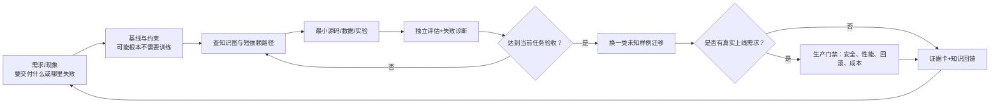

# LLM Learning Roadmap V3｜需求驱动、知识依赖、实战到生产能力

> **本文件是在 [V2.0（M01–M12）](ROADMAP-V2.md) 基础上的扩展，不废弃旧实验，也不要求依次学完 12 章。**
>
> 状态：**CURRICULUM READY / LEARNER UNASSESSED / PRODUCTION NOT VERIFIED**。本仓是独立的 **LLM 专项学习操作系统**，目标覆盖研发与上线需要的知识和技能；它不是某一个下游产品的研发仓，也不承接客户/订单事实。真实产品源码与线上数据属于其各自仓库。

## V3 全栈扩展｜补齐上游六域而不替换训练模块

你现在可从 [**LLM 六域全景图**](knowledge-graph/LLM-FULL-STACK-ATLAS.md) 看清一条完整技术系统（Foundation、Training Systems、Post-training、Model Engineering、Applications、LLMOps）与多模态/安全/评估/成本横切层。这里是**知识广度**，与本 Roadmap 的 M01–M12 **能力深度**互补。

- [33 个主题的上游一键链接 + 官方参考](resources/UPSTREAM-RESOURCE-MAP.md)：按领域直接指向上游固定文件、专业原理和官方资料；当前不会全部精读也能知道将来去哪找。
- [12 张需求驱动任务卡](demand-driven/AI-NATIVE-NEED-ROUTES.md)：从 RAG 引用、Tool Calling、显存、GRPO、KV Cache、多模态、模型发布、API 选型等任意当前问题进入。
- [AI-Native 导师提示词与学习闭环](learning-method/AI-NATIVE-LEARNING-LOOP.md)：专业定义 + 大白话 + 公式/接口 + 两种反例 + 最小可运行实验 + 未知场景迁移 + 停止规则。
- [可检索 Atlas 目录](index/upstream-knowledge-index.json)：6 域、33 主题、30 条类型化知识关系、12 需求、21 官方入口；原有 [12 模块/18 需求索引](index/learning-index.json) 保持独立。

**明确定位**：上游的历史深工程 M00–M17 与本仓 M01–M12 编号不同；全栈主题使用 F/S/P/E/A/O + 数字，也不是学习顺序。RAG、Agent、MCP 属应用体系，不改写为后训练的三个新模块。知识地图不强制每个主题到 L3/L4；按需要先 L0 知道在哪里，出现真实 Gap 再做深度学习。

## 0. 三个不同的“顺序”，不要混淆

1. **客观知识关系**：如理解 DPO 的 log-prob 需要 CE/概率基础；理解 KV Cache 需要 causal attention；这是“前置依赖”，不会因为需求改变而消失。
2. **个人学习顺序**：可以从“工具调用乱码”“吞吐过低”“GRPO 没奖励”进入，先做小型诊断，再仅补欠缺的前置知识；**绝非强制 M01 → M12**。
3. **真实系统生命周期**：问题/约束 → 基线 → 数据 → 训练或免训练 → 验证 → 部署 → 监控 → 反馈。这是产品和实验的工作流程，**不等于个人读书顺序，也不是本仓必须实现一个固定下游产品的路线**。

一项能力不等于一次课程：**能够解释（Why）→ 自己实现（Build）→ 定位失败（Debug）→ 对照验证（Measure）→ 陌生场景迁移（Transfer）→ 满足生产门禁（Operate）**。

## 1. 一张关系图：学什么、为什么相关、哪里可跳

- **需求入口**：[按问题检索](demand-driven/README.md)、[可执行路由命令](tools/route_learning.py)、[示范需求卡](demand-driven/worked-demand-cards.md)。
- **理解关系**：[语义依赖与跨层连接](knowledge-graph/dependency-and-capability-map.md)、[12 模块](README.md)。
- **真正学会**：[可运行的合成工具调用安全/证据垂直切片](labs/synthetic-tool-gateway/README.md)、[实验阶梯](labs/capability-ladder.md)、[独立能力评分](assessments/CAPABILITY-RUBRIC.md)。
- **准备真实上线**：[生产门禁](production/PRODUCTION-READINESS.md)，不是仅“服务能启动”。
- **查可信资料**：[权威来源索引](resources/AUTHORITATIVE-INDEX.md)，以官方文档/论文/源码为准。

## 2. 保留 12 模块，深度从“知识点”扩为“可操作能力”

表中的模块 ID 是本仓 V2/V3 编号；**上游旧 M00–M17 是另一套历史教学序号，不直接同号映射**，见 [跨仓索引](index/UPSTREAM-DOWNSTREAM.md)。

| 模块 | 理论层必须解释 | L2/L3 实践与排错 | 对上线能力的覆盖 |
|---|---|---|---|
| [M01](modules/M01.md) Tensor/CE/AdamW | 自动微分图、优化器状态、数值稳定、统计推断 | 手推梯度与显存、梯度检查、OOM/NaN 归因 | 训练安全与成本 |
| [M02](modules/M02.md) 数据/Token | 词表、packing、数据分布、质量/许可、泄漏 | 数据清洗/抽样/版本、毒性/PII/污染负例 | 数据可信性与可追踪 |
| [M03](modules/M03.md) Transformer | RoPE/GQA/Attention/KV/长上下文 | 张量对照、Attention profile、context 退化 | 模型选型/推理瓶颈 |
| [M04](modules/M04.md) Pretrain | CE、Scaling Laws、混合精度、checkpoint | MiniMind 真实训练/恢复/优化器状态核对 | 训练循环与恢复 |
| [M05](modules/M05.md) CPT | 领域适配与遗忘、Replay、调度器 | 域内/域外受控对照、RAG vs CPT 判定 | 领域适配决策 |
| [M06](modules/M06.md) SFT/PEFT | Assistant mask、QLoRA、合成轨迹、模板 | 真实 tool template token 验证、过滤造数、全流程 SFT | 可靠工具调用 |
| [M07](modules/M07.md) Preference | RM/PRM/DPO/Online DPO、偏好偏差 | chosen/rejected 构造、离线/在线辨析、WinRate | 行为偏好与安全 |
| [M08](modules/M08.md) RL | PPO/GRPO、RLVR、Reward Hacking、Agentic RL | Rollout/Verifier/Advantage 诊断，失败轨迹审计 | 可验证动作策略 |
| [M09](modules/M09.md) Systems | HBM/IO、FSDP/ZeRO、通信/Profiler | GPU profile、资源规划、故障恢复与权重同步 | 吞吐/资源效率 |
| [M10](modules/M10.md) Eval | 统计显著性、任务指标、回归、泄漏 | 离线数据集与线上反馈闭环、红队负例 | 发布证据与监控 |
| [M11](modules/M11.md) Serving | 量化/蒸馏/缓存/Continuous Batching | vLLM 部署、TTFT/P95/吞吐压测、回滚 | 上线运维与性能 |
| [M12](modules/M12.md) Advanced | MoE、多模态、长上下文、Agentic RL | 按需求作跨领域小实验，不默认大训练 | 新场景/架构扩展 |

**横切深度**：安全/数据治理、用户授权、服务可观测、隐私/模型许可证、CI/CD、经济性、版本回滚；不是给第 13 模块打卡，而是所有涉及生产的任务都要过 [门禁](production/PRODUCTION-READINESS.md)。

## 3. 从“现象/需求”选择学习路径，不是从第 1 章进入

| 触发 | 首先做的验证 | 只补这些知识 | 核心实战 |
|---|---|---|---|
| Tool Call 结构不稳定 | 固定 JSON schema 基线 vs Prompt/模板 | M02→M06→M10 | SFT mask 与参数精度、真实工具执行 |
| RAG 引用编造 | 拆 Retrieval / Evidence / Generation | M10→M06；必要时 M02/M05 | 引用逐 claim 核验与拒答 |
| 模型服务 P95 太高 | 定位排队/Prefill/Decode/网络 | M11→M03→M09 | profile、批量和缓存对照 |
| GPU OOM / NaN | 分块测峰值+优化器状态 | M09→M01→M04 | 固定条件下减 seq/checkpoint/量化 |
| 领域知识不足 | RAG、Prompt、CPT、SFT 分别基线 | M10→M05→M02 | 防遗忘/重放的保留集对照 |
| DPO 导致退化 | 偏好标签质量和参考策略核对 | M07→M06→M10 | 静态/自采样偏好消融 |
| GRPO 奖励投机 | 对照独立正确率、Group std | M08→M07→M10/M09 | Verifier 反作弊和 Rollout |
| 工具任务真实上线 | 先实现不训练的基线和 NFR | M10/M11→M06→M09 | 端到端监控、权限、回滚 |
| 多模态/长上下文 | 先评估需求是否必须 | M12→M03/M02→M10 | 性能/正确性/吞吐回归 |
| 需要微调还是 API | 先算成本与验收 | M10→M11→按需 M05/M06 | Build-vs-Buy 证据表 |

完整路由和边界见 [需求图谱](demand-driven/README.md)。

## 4. 工程能力阶梯：不仅“学过”，还要能交付

| 层级 | 学习者需要提供的证据 | 不能替代它的证据 |
|---|---|---|
| L0 定位 | 需求是什么、应归哪个模块、为什么相关 | 收藏论文 |
| L1 解释 | 原理、核心公式、输入输出、边界、关系 | 复制术语 |
| L2 自己实现 | 可复现源码/命令/最小单测/检查点 | 只成功调用封装 API |
| L3 诊断与比较 | 负例、受控消融、Profile、统计局限 | 只展示成功案例 |
| L4 独立迁移 | 不看教程处理新任务、部署与回滚演练 | CI 绿灯或模型成绩高 |

**L0–L4 是本 V3 的能力刻度**；V2 使用 L1–L3 教学刻度，旧评语不能未经重新评估便直接升级为 L4。实际评分细则见 [Rubric](assessments/CAPABILITY-RUBRIC.md)。

## 5. “五类训练实验”仍保留，但不是完成真实产品的唯一解

- [01 MiniMind](experiments/01-minimind-whitebox/README.md) 用于理解底层机制；不是为了创造另一个独立框架。
- [02 CPT](experiments/02-qwen-cpt-replay/README.md) 关注何时继续训练及防遗忘；不默认领域知识全部应注入参数。
- [03 Tool SFT](experiments/03-agent-tool-sft/README.md) 解决可验证的结构化任务；若 Prompt/规则足够，**可以不微调**。
- [04 DPO](experiments/04-dpo/README.md) 通过偏好数据调行为；不承诺优于直接 SFT。
- [05 GRPO](experiments/05-grpo/README.md) 理解在线奖励与优化；单卡 16GB 先小预算，失败也可构成学习证据。
- [06 Production](experiments/06-deployment/README.md) 已有模型与系统的性能/部署练习；**不视为第六类训练算法**。

四个旧里程碑仍保留为**覆盖与验收坐标**，而不是学习日程。需求驱动的任一任务可以从 M11/M10 进入；完成后回到关系图补有用前置，而不是补读全部课表。

## 6. 为真实上线补的 8 个跨学科能力区

1. **需求与免训练决策**：Prompt/规则、RAG、检索增强、SFT、CPT、DPO/RL、云 API 与自托管，必须有可比基线和成本。
2. **数据工程**：可授权来源、隐私、重复/泄漏、训练样本与评估样本独立、合成数据验证与数据卡。
3. **算法可解释**：Loss、Optimizer、Attention、PEFT、Preference、Policy Gradient 与误差原因。
4. **评估科学**：任务明确定义、错误分类、可信判分、抽样不确定性、模型/数据版本、线上回归。
5. **推理与服务系统**：kv/prefill/decode、并发、限流、缓存、降级、负载、量化和成本。
6. **可靠 Agent/工具**：schema、tool timeout、重试/幂等、权限、观察性、审计日志和安全执行边界。
7. **运维与安全治理**：灰度/回滚、追踪、隐私、prompt injection、访问控制、机密管理、数据保留。
8. **可迁移产品能力**：陌生输入/新领域/新系统接口重复做出可评估的结果，证明不是记住 demo。

这 8 区是学习范围覆盖矩阵，**不是要求当前学习仓变成 SaaS 工程仓**。

## 7. 应用落地方向是“验收场景”，不是仓库的唯一客户

至少能够选择并验证以下**相互不同**的情境：
- **检索与可信回答**：不同文档与权限，带引用和拒答；不需先训练模型。
- **多轮工具任务**：真实执行 schema、超时、重放、安全回退；可探究 SFT/Preference。
- **模型部署平台**：服务并发/TTFT/成本/限流/监控/切换；训练可为零。
- **领域适配与推理训练**：CPT/QLoRA、DPO、GRPO，必须证明优于更简单基线。
- **多模态/长上下文**：在需求确实触发后扩展，不为了 M12 名字堆 GPU。

每一个场景只需做能独立运行的**最小垂直切片**，且须在未知样本上复验；本学习仓保存方法、最小公开/合成实验与证据链接，**完整产品工程在其他实际项目仓**。

## 8. 学习会话操作协议（随需执行）

1. 写需求/症状、源头及日期、期待行为、实际失败、约束；真实合同/JD/敏感数据只存原权威仓。
2. 做 **0 训练基线**：规则、现成模型/API、Prompt/RAG、现有部署；确定是否真是训练问题。
3. 从 [机器索引](index/learning-index.json) 或 `python LLM-Training/tools/route_learning.py --list` 选路由；只查当前 Gap 需要的官方文档。
4. 读专业定义和白话解释，画输入→中间变量→输出及典型反例；在 MiniMind/TRL/系统源码中定位对应函数。
5. 做最小实验，固定数据/指标/Seed/版本，至少包含失败样本与一项受控改动。
6. 独立解决新样例、说明不用本技术的条件；达到当前验收就 **STOP**。
7. 若后续需要真正上线，再按 [发布门禁](production/PRODUCTION-READINESS.md) 做安全、回归、运维/成本，不把 Demo 成功当上线。

**可执行载体**：[需求卡模板](demand-driven/DEMAND-CARD-TEMPLATE.md) 与 [能力训练/迁移任务](labs/capability-ladder.md)。时间分配可沿用 V2 的 45% 实验/25% 原理/20% 复盘/10% 表达，但按实际瓶颈调整而不是按周限额。

## 9. 权威资料使用方法和版本边界

以官方模型/框架文档、论文原文、源码和上游的 [LLM Atlas](https://github.com/Xander-Xai/X-SuperPlay-AI-Learning-OS/tree/main/docs/atlas) 为主要依据。任何培训材料都应能追到具体出处、关键 commit/版本、已验证假设和反例，参见 [Source Index](resources/AUTHORITATIVE-INDEX.md)。

尤其注意：版本不断变动的 TRL、Transformers、vLLM、Unsloth、verl 不能仅凭旧博客配置直接复现；记录本机版本和日期。**已验证框架文档存在 ≠ 本机 CUDA/GRPO 能跑 ≠ 真实产品上线。**

**上游/下游分工**：[跨仓入口与知识权威](index/UPSTREAM-DOWNSTREAM.md)。

## 10. 第三轮严格验收补强：所有模块都必须带可执行的深挖任务

原 V3 仅有全局概览，M01–M12 独立内容仍偏概要。本次已在[12 模块学习中心](README.md)逐个补充：**专业原理 → 白话解释 → 具体输入/输出 → 受控实践 → 失败反例 → 官方来源 → 能力门槛**。模块不只是培训大纲，按实际需求任意进入即可。

**三条可立即运行的跨环节练习线**：
1. M06 工具可信边界：[标准库 Gateway](labs/synthetic-tool-gateway/README.md)，验证授权/参数/证据，不依赖模型。
2. M07/M08 后训练核心：[DPO/GRPO 数学实验](labs/preference-rl-math/README.md)，学习 log-ratio、组内奖励方差和 Reward Hacking；不冒充真正策略更新。
3. M10 评估：[任务级离线指标实验](labs/task-evaluation/README.md)，区分 Tool selection、参数、执行、引用、拒答和 E2E 的分母与不确定性。

[机器索引](index/learning-index.json)现为每个模块记录 `sources`、`practice`、`question` 与 `gates`，问题路由有中英同义词并支持按模块反查：`python LLM-Training/tools/route_learning.py --module M11`。但这仍是**人工策划的关键词入口**，不是无限语义检索或自动获取私人项目需求。

后续若要完成真实 Qwen 微调、线上负载及独立技能评估，仍须在有权限的环境实际执行并留下可审查记录。第三轮 [验收报告](ACCEPTANCE-V3-AUDIT.md)只验收课程资产和静态/教学运行，不虚构 GPU 训练结果。
