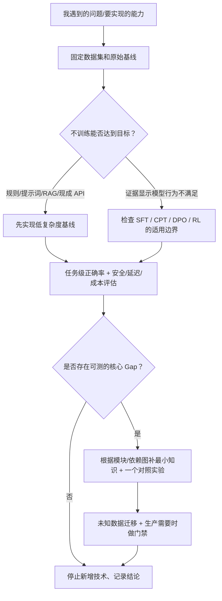

# 按需求跳学｜从失败现象反查最短知识依赖

## 本轮新增应用工程需求入口

[10 项应用工程专题及检索命令](../application-engineering/index/README.md) 补充 **RAG / Ragas / Agent Harness / Context / Prompt / Tool Safety / Trace Eval / Project Engineering** 等横向能力。与原训练 [19 条需求](../index/learning-index.json) 及 [12 张六域卡](AI-NATIVE-NEED-ROUTES.md) 并存，不是另外一个按周打卡计划。

遇到引用不可信 → [RAG/Eval](../application-engineering/RAGAS-EVALUATION.md)；上下文变长/遗漏约束 → [Context](../application-engineering/CONTEXT-ENGINEERING.md)；工具越权/长任务失败 → [Harness](../application-engineering/AGENT-HARNESS-ENGINEERING.md)；输出格式/版本回归 → [Prompt](../application-engineering/PROMPT-ENGINEERING.md)。

**完整大模型六域版本**：新增 [12 张跨训练/推理/应用/生产的任务卡](AI-NATIVE-NEED-ROUTES.md)、[全局知识关系](../knowledge-graph/LLM-FULL-STACK-ATLAS.md) 与 [AI 原生学习协议](../learning-method/AI-NATIVE-LEARNING-LOOP.md)。以下原有 19 条训练症状索引仍可用，面向 M01–M12 训练模块；两套索引分别负责全栈概念广度和训练专项深度。

**用户真实问题优先于课程顺序**。这里的“需求”包含：工程故障、科研问题、职业任务、纯兴趣问题、准备上线的产品需求；不必先拥有真实客户项目，才能学习底层知识。训练卡可以是 **SELF_CHOSEN / SYNTHETIC / AUTHORIZED_TASK / HISTORICAL**，不得将模拟需求写成已成交业务。

## 1. 需求分流：先问要不要训练



**用户从 M11 开始完全合理**：假如问题是 vLLM 请求 P95 超标，直接读 M11/M09，不必先复现 MiniMind 预训练。只有遇到 KV Cache 或计算机制理解障碍时再补 M03。

## 2. 问题路由表（精选入口）

| 我当前遇到的情况 | 首个验证动作 | 直达模块与实验 | 生产关联 |
|---|---|---|---|
| 想做可上线的 RAG | 检索-证据-生成基线，权限样本 | [M10](../modules/M10.md) → [M06](../modules/M06.md) | 引文/拒答/泄漏 |
| 工具选错/参数无效 | 抽样与 JSON schema/模板测试 | [M06](../modules/M06.md) → [M02](../modules/M02.md) | 工具权限/超时/幂等 |
| QLoRA OOM | 峰值、optimizer、seq len 分账 | [M09](../modules/M09.md) → [M01](../modules/M01.md) | 资源成本 |
| CPT 后通用能力下降 | 固定通用与域内 held-out | [M05](../modules/M05.md) → [M10](../modules/M10.md) | 领域风险 |
| 需要学 Qwen3 真微调 | Base/LoRA/Full 预算与任务对照 | [M06](../modules/M06.md) → [03 Tool SFT](../experiments/03-agent-tool-sft/README.md) | 版本/回滚 |
| 数据集太乱/样本污染 | 源/许可证/重复/泄漏扫描 | [M02](../modules/M02.md) → [数据清单](../data-engineering/tokenizer-and-packing.md) | 安全与合规 |
| DPO 变差/答非所问 | 偏好对正确性与长度偏差 | [M07](../modules/M07.md) → [04 DPO](../experiments/04-dpo/README.md) | 行为回归 |
| GRPO reward 高但不正确 | 评分漏洞、group std、held-out | [M08](../modules/M08.md) → [05 GRPO](../experiments/05-grpo/README.md) | 奖励投机 |
| 想做 Agentic RL | 先建确定性多步工具沙盒 | [M08](../modules/M08.md) → [M12](../modules/M12.md) | 环境安全 |
| 模型 P95/吞吐差 | 分析 Prefill/Decode/排队 | [M11](../modules/M11.md) → [M03](../modules/M03.md) → [M09](../modules/M09.md) | SLO/成本 |
| 需要量化或蒸馏 | 固定质量/延迟/显存基线 | [M11](../modules/M11.md) → [M10](../modules/M10.md) | 回归与许可 |
| 想看工业分布式 RL | Rollout/训练分工与同步图 | [M09](../modules/M09.md) → [M08](../modules/M08.md) | 多机稳定性 |
| 训练损失 NaN | 梯度、mask、dtype、学习率 | [M01](../modules/M01.md) → [M04](../modules/M04.md) | 可恢复性 |
| MiniMind 不理解 attention | 对比小张量与模型内部 | [M03](../modules/M03.md) → [01 白盒](../experiments/01-minimind-whitebox/README.md) | 模型分析 |
| 新领域要做多模态 | 先定位视觉/文本失效 | [M12](../modules/M12.md) → [M02](../modules/M02.md)/[M10](../modules/M10.md) | 多模态评测 |
| 学训练全栈但无真实项目 | 选择一项合成可核验任务 | [五类实验](../experiments/README.md) → [能力阶梯](../labs/capability-ladder.md) | 迁移演练 |

**新路由用法**：`--search QLoRA`、`--search 工具调用`、`--module M11`，按中英别名或模块反查；它是静态关键词索引，不能理解任意自然语言意图，未命中时用 [需求卡模板](DEMAND-CARD-TEMPLATE.md) 扩增。

**完整可机读路由**：[learning-index.json](../index/learning-index.json)。终端查看：`python LLM-Training/tools/route_learning.py --list` 或 `--id tool-calling`。脚本不联网、不读取私人仓库。

## 3. 一个训练会话只解决一个明确的问题

1. **触发**：记录真实/模拟场景，区分事实与假设，最好量化“原来做不到什么”。
2. **反选方案**：是否可以用简单规则/Prompt、现成模型/API、RAG 解决？明确不训练基线。
3. **定义验收**：主指标 + 安全/成本护栏 + held-out 及负例，先定再练。
4. **诊断知识**：找到一个当前 Gap，反向回溯最多 1–3 个真正缺失前置（不是封顶知识复杂度）。
5. **权威学习**：一份官方文档/论文 + 一个源码入口，不把大量三方博客当等价来源。
6. **最小实验**：固定输入、版本、seed；只改一个变量；比较成本和错误原因。
7. **自己完成**：关闭参考资料复现/解释并迁移到不同输入；不能只靠 AI 改脚本算掌握。
8. **停止或升级**：达到当前能力门槛就停；若真需上线再过 [生产门禁](../production/PRODUCTION-READINESS.md)。

## 4. 学习路线与学习顺序不冲突

```text
完整知识地图：永远保留 M01–M12、关系和源文档
本次任务：只点亮当前实际使用的少量节点
学完任务：留下证据、未知节点、何时复学；不强迫打卡剩余模块
```

一张任务卡只记录“今天此需求的掌握”，不升级整仓所有知识点。一个小测试成功，最多证明这个**局部合同**成立。

## 可直接运行的三项补课

- 对齐/DPO/RL 原理：[DPO/GRPO 组内优势与奖励投机公式实验](../labs/preference-rl-math/README.md)（无模型训练）
- 模型/Agent 最终任务如何量化：[合成任务级评测](../labs/task-evaluation/README.md)（非真实延迟/生产基准）
- 工具权限/参数/证据如何守住系统边界：[合成工具网关](../labs/synthetic-tool-gateway/README.md)（非真实服务）

## 5. 可直接复制的材料

- [需求卡模板](DEMAND-CARD-TEMPLATE.md)：来源、问题、测试、最短依赖、证据和停止规则。
- [五张示范需求卡](worked-demand-cards.md)：RAG、工具调用、Serving、CPT、GRPO 的反例驱动路径。
- [能力阶梯与独立练习](../labs/capability-ladder.md)：从源码到陌生迁移的六种练习方式。
- [权威资料](../resources/AUTHORITATIVE-INDEX.md) 与 [能力评分](../assessments/CAPABILITY-RUBRIC.md)。

**不要把真实客户/岗位、账户 ID、合同、企业秘密复制到本仓**。真实需求只做经授权的脱敏描述；原数据及最终产品交付证据由原权威仓管理。

