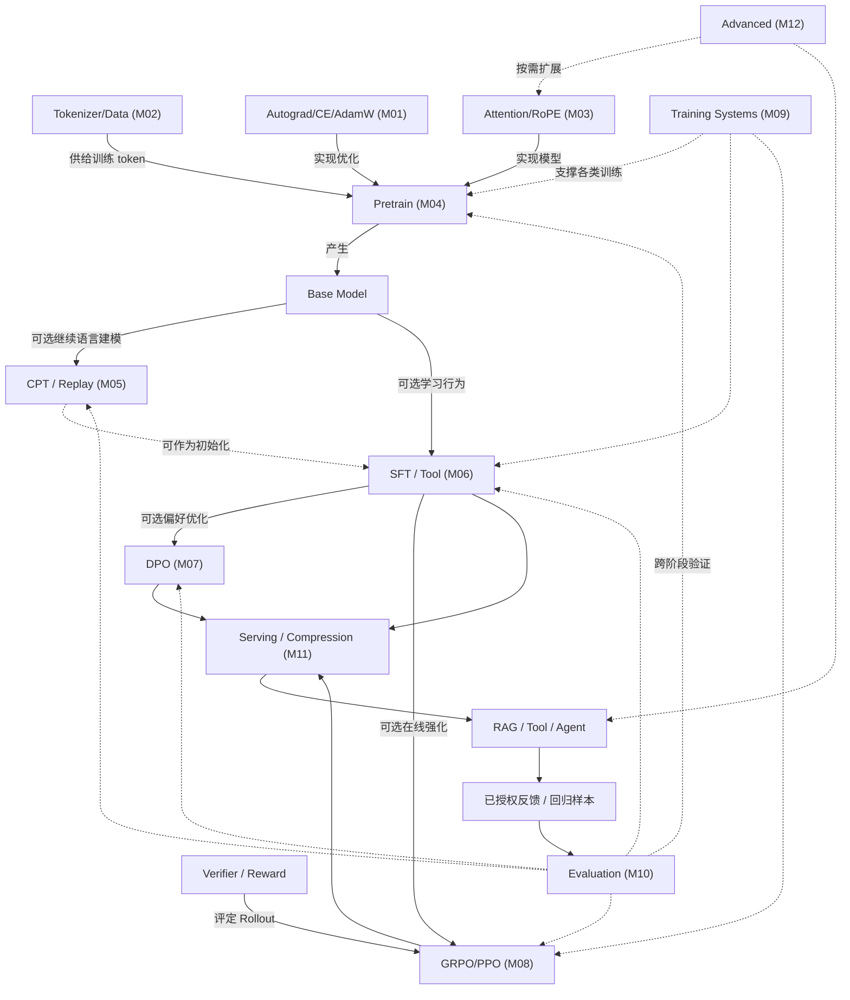

# LLM 知识关系图 V3：前置、优化、替代与验收的区别

**新增全栈版本**：[Foundation→Serving→RAG/Agent→LLMOps 六域地图](LLM-FULL-STACK-ATLAS.md)，并与 [33 主题上游文档导航](../resources/UPSTREAM-RESOURCE-MAP.md) 形成双向入口。本页保留训练专项的模块级依赖图，两张图是不同抽象层级，不应强制按箭头线性学习。

> 此图是语义地图，不是推荐线性课程。新需求应从症状开始，只向后回溯必要知识；学习完再顺着“验证/部署”方向确认能力。

## 1. 技术层的真实语义关系

**非必经关系**：CPT 不要求先做 SFT；DPO 和 GRPO 不必须串行；未训练的新模型也可以直接 Serving；RAG/Tool 可能不需要任何本地训练。

## 2. 关系类型与判断问题

| 关系 | 示例 | 判断问题 |
|---|---|---|
| 前置 requires | DPO → log-prob/偏好数据 | 不会这个会导致什么理解/实现失败？ |
| 实现 implements | FlashAttention → exact attention | 优化是否改变数学输出或只减少 IO？ |
| 产生 produces | Pretrain → Base Model | 输入、输出及权重状态是什么？ |
| 优化 optimizes | GQA → KV Cache | 哪个瓶颈减少，有什么损失/取舍？ |
| 可替代 alternative | RAG ↔ CPT（某些知识问题） | 不训练的最低成本基线是否更好？ |
| 评测 evaluated_by | Tool SFT → Task success | “loss 下降”能否证明任务完成？ |
| 部署 deploys | vLLM → serving stack | 配置、模板、负载、回滚怎样关联？ |
| 依赖 depends_on | Agent → tool auth + observation | 模型训练不能替代哪些系统保证？ |

同一概念可同时拥有多个边，但边必须有清楚语义和方向；不写“XX 与 YY 相关”。上游规范：[relationship-rules](https://github.com/Xander-Xai/X-SuperPlay-AI-Learning-OS/blob/main/docs/atlas/relationship-rules.md)。

## 3. 实际问题的最短回溯示例

**问题：自定义模型 tool call 选择错**：
- 先验证 API tool parser、Prompt、schema 和无训练基线；它们失败时不一定需要 SFT。
- 若确认为模型行为：M06 labels/模板 → M02 token 边界 → M10 端到端验证。
- 若涉及偏好：M07 的 chosen/rejected 质量 → M10 业务正确率。
- 训练后再查 M11 推理模板兼容与发布回归。

**问题：vLLM P95 变差**：
- 先分离排队、网络、Prefill/Decode、sampling、冷启动；若 KV 相关才学 M03。
- 用 M11 serving、M09 profile，可能完全不需要 M04 预训练。
- 性能变好还要检查 Tool Call 正确率和超时后的系统行为。

**问题：GRPO reward 上涨但正确率下降**：
- M08 reward/advantage/rollout → M10 独立测试与泄漏 → M07 偏好/验证器偏差。
- 低显存 OOM 才回 M09；不是每个 RL 任务都必须先学 FSDP。

## 4. 两种成果必须分开保存

**知识证据**：原理、公式、最小源码、可复现测试、实验状态、反例，保留在本专项仓。

**产品证据**：真实数据源/合同、服务源码、部署日志、线上指标、客户 UAT、权限和回滚记录，保留各自拥有的项目/事实仓；本仓只放脱敏链接。详见 [跨仓索引](../index/UPSTREAM-DOWNSTREAM.md)。

## 5. 未知知识如何新增节点

1. 判断它属于上游六域（Foundation/Training/Posttrain/ModelEng/App/Production）还是横切平面；
2. 找最短学习前置，避免把工具名称变成永久模块；
3. 标注输入/输出、替代方案、可观测失败和测试；
4. 链至 M01–M12 一个或多个模块，不必改 12 模块编号；
5. 只对稳定原理回写上游 Canonical Knowledge，对框架配置留版本和源码引用。

